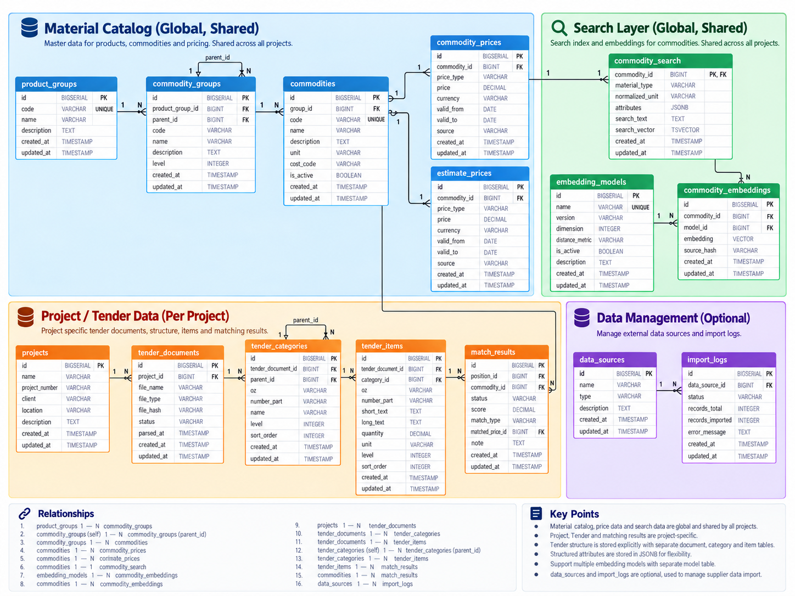
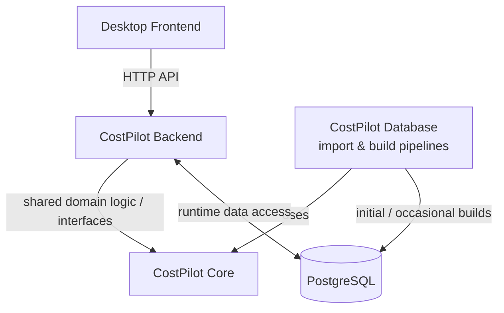

# CostPilot Database

CostPilot Database provides the PostgreSQL schema, catalog import tools, and derived-data build workflows for CostPilot. The supplier material catalog is treated as a **mostly static, shared dataset**: it is prepared once and reused across projects. New **projects and LV documents** are the main sources of data changes during normal operation.

**Scope:** This repository owns database schema setup, catalog ingestion, structured-data generation, embedding generation, and persistence. **Retrieval, ranking, reranking, matching, and API workflows belong to CostPilot Backend.**



## System Architecture

CostPilot is divided into three codebases with distinct responsibilities:

| Component | Responsibility |
| --- | --- |
| **costpilot-core** | Shared domain models, material extraction, text building, and abstract Embedding / Reranker interfaces. No database access or concrete model loading. |
| **costpilot-database** | PostgreSQL schema, catalog import, search-data and embedding builds, and database access utilities for the ingestion workflows. |
| **costpilot-backend** *(next development phase)* | Application APIs, project / LV lifecycle, PostgreSQL access for runtime operations, retrieval, ranking, and material matching. Loads concrete models as needed. |



**Important:** `costpilot-database` is not a separate HTTP service that Backend must call on every request. It supplies the database structure and offline/maintenance build tools. During normal operation, Backend connects to the shared PostgreSQL instance through its own data-access layer. Backend and Database can both depend on Core without Core depending on either of them.

## Data Model

Imported supplier data remains the source of truth:

```text
product_groups -> commodity_groups (hierarchical) -> commodities
                                                       |-- commodity_prices
                                                       `-- estimate_prices
```

- `data_sources` identifies suppliers/catalogs; `import_logs` records import attempts and outcomes.
- `commodity_search` stores material classifications, structured attributes (`JSONB`), and `search_text`. PostgreSQL derives `search_vector` (`TSVECTOR`) and maintains its GIN index automatically. This prepares keyword-search data; it does **not** implement Backend retrieval or BM25 ranking.
- `embedding_models` records model identity and vector metadata; `commodity_embeddings` stores model-specific vectors, uniquely identified by `(commodity_id, model_id)`.
- `projects`, `lv_documents`, `lv_positions`, and `match_results` are already defined in the schema. Their normal create/update/read workflows will be implemented in Backend.

Schema: [`sql/schema_v2.sql`](./sql/schema_v2.sql) (PostgreSQL + pgvector).

## Data Lifecycle

### Phase 1 — Catalog Import (initial setup or rare catalog updates)

`CatalogImportPipeline` reads the supplier XML, parses and validates it, and upserts the original catalog through `CatalogImporter`. Import attempts are tracked in `import_logs`.

### Phase 2 — Search Data Build (after catalog import)

`SearchIndexPipeline` reads existing Commodity records and runs two independent operations:

- **`SearchImporter`** extracts structured material attributes into `commodity_search`; PostgreSQL maintains `search_vector` and its GIN index.
- **`EmbeddingImporter`** uses Core's `TextBuilder` and a concrete model implementation loaded outside Core to populate `commodity_embeddings` (currently BGE-M3, 1024 dimensions).

Both pipelines are implemented in `src/pipelines/` and called by `scripts/build_database.py`.

**Normal runtime:** These import/build pipelines are **not** executed each time Backend starts or when a new Project/LV is created. The existing material catalog and search data are reused. Backend saves new Project/LV data, retrieves material candidates, performs matching, and persists match results. Rebuild catalog-derived data only when the catalog, extraction rules, embedding model, or encoding configuration changes.

## Configuration

Create a local `.env` (do not commit it):

```dotenv
POSTGRES_DB=costpilot
POSTGRES_USER=costpilot
POSTGRES_PASSWORD=<local-password>
POSTGRES_HOST=localhost
POSTGRES_PORT=5434

CATALOG_XML_PATH=./data/imports/Artikel_extended_434_commodities.xml
MODEL_CONFIG_PATH=./config/models.yml
```

`config/models.yml` contains model names, versions, and local paths. Adjust model paths for the target machine. The database container and schema v2 must exist before running the data-build command.

## Build Commands

Run from the `costpilot-database` repository root:

```bash
# Initial full build (writes and commits data)
uv run --env-file .env python -m scripts.build_database all

# Catalog XML import only
uv run --env-file .env python -m scripts.build_database catalog

# Rebuild both structured data and embeddings from existing commodities
uv run --env-file .env python -m scripts.build_database index

# Structured data only
uv run --env-file .env python -m scripts.build_database index --index-part search

# Embeddings only
uv run --env-file .env python -m scripts.build_database index --index-part embedding

# Select an embedding model defined in config/models.yml
uv run --env-file .env python -m scripts.build_database index --index-part embedding --model-key bge-m3
```

These commands **persist changes**. They are maintenance/initialization commands, not regular application-startup commands. The current build regenerates embeddings even when the source text has not changed.

## Backend and Docker Startup (planned integration)

The PostgreSQL container is currently managed by the Database project's Docker Compose setup. When Backend is introduced, the intended deployment is **one top-level Docker Compose project** managing both PostgreSQL and Backend:

1. Start PostgreSQL with a persistent volume.
2. Wait until PostgreSQL passes its container health check (`pg_isready`).
3. Start Backend with `depends_on: postgres: condition: service_healthy`.
4. Backend checks the database connection and required schema/data compatibility before enabling database-dependent functionality.
5. The Desktop application communicates with Backend over its API; it does not access PostgreSQL directly.

Example *Compose fragment* (illustrative only; integrate with the existing database service, volumes, environment, and Backend Dockerfile):

```yaml
services:
  postgres:
    # Existing PostgreSQL / pgvector service configuration goes here.
    healthcheck:
      test: ["CMD-SHELL", "pg_isready -U $$POSTGRES_USER -d $$POSTGRES_DB"]
      interval: 5s
      timeout: 3s
      retries: 12

  backend:
    # Backend build/image configuration goes here.
    depends_on:
      postgres:
        condition: service_healthy
    environment:
      POSTGRES_HOST: postgres
      POSTGRES_PORT: "5432"
```

The future unified deployment command will be `docker compose up -d --build` from the deployment directory **once this Compose configuration is implemented**. The host-side port `5434` in the Database `.env` is not the container-network port: Backend should normally use service host `postgres` and port `5432` inside Compose.

**Health check vs. data readiness:** `pg_isready` only confirms that PostgreSQL accepts connections. It does not prove the catalog, structured data, embeddings, or schema version are complete. A Backend startup/readiness validation is still pending. Missing or incompatible data should produce a clear error or unavailable-feature state, **not automatically trigger a full catalog/embedding rebuild**.

## Tests

The `tests/` directory contains unit tests and optional PostgreSQL integration tests:

```bash
uv run --env-file .env pytest tests/unit -v
```

Use a **dedicated test database** for integration tests; see `tests/README.md`. Tests should roll back changes and not leave imported test data in the real catalog.

## Current Status and Deferred Work

**Ready for Backend development:** Schema v2, Dockerized PostgreSQL for development, XML catalog import, structured-data generation, TSVECTOR/GIN support, BGE-M3 embedding generation, and unified build commands have been implemented and tested with the current 434-Commodity catalog. Catalog-derived data has been rebuilt and stored for use by the next phase.

**Deferred / planned:**

- Backend runtime persistence for Projects, LV documents/positions, and match results; all retrieval/ranking/matching functionality.
- Unified Backend + PostgreSQL Compose orchestration and startup compatibility/readiness validation.
- Schema migrations, backup/restore, and deployment hardening.
- Optional incremental rebuilds, catalog deletion reconciliation, and model/extraction-version tracking **if supplier data or models change in the future**.
- Additional production-environment integration and failure/recovery tests.

The supplier catalog is assumed to remain mostly unchanged; the above maintenance items do not block Backend development.
