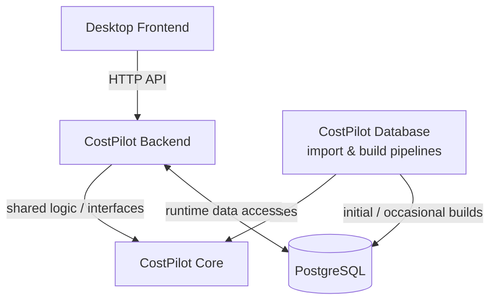

# CostPilot Database

CostPilot Database 负责 PostgreSQL Schema、供应商 Catalog 导入，以及 Structured Data 和 Embedding 的构建。

当前系统采用一个重要的业务假设：**供应商材料与价格 Catalog 基本固定**，初始化完成后作为所有项目共享的数据基础，日常运行不需要反复导入。未来持续变化的主要是**新建 Project、导入新的 LV，以及每个 LV Position 的匹配结果**。

**项目边界：** 本仓库负责数据库结构、数据导入、预处理和持久化；实际 **Retrieval、Ranking、Reranking、Matching 和 API** 全部由 CostPilot Backend 实现。


## System Architecture（系统架构）

CostPilot 分为三个职责清晰的代码项目：

| 项目 | 主要职责 |
| --- | --- |
| **costpilot-core** | 共享领域模型、材料属性提取、TextBuilder，以及 Embedding / Reranker 抽象接口；不访问数据库，也不加载具体模型。 |
| **costpilot-database** | PostgreSQL Schema、Catalog Import、Structured Data / Embedding 构建，以及导入流程使用的数据库访问代码。 |
| **costpilot-backend**（下一阶段） | API、Project / LV 业务流程、运行时数据库访问、检索、排序、材料匹配；按需加载具体模型。 |



**注意：** `costpilot-database` 不是一个需要 Backend 每次通过 HTTP 调用的独立服务。它提供 Schema、导入逻辑和构建工具。正常运行时，Backend 通过自己的 Data Access Layer 直接连接共享的 PostgreSQL。Backend 和 Database 都可以依赖 Core，但 Core 不反向依赖它们。

## Data Model（数据库结构）

供应商原始数据是 Catalog 的 Source of Truth：

```text
product_groups -> commodity_groups (hierarchical) -> commodities
                                                       |-- commodity_prices
                                                       `-- estimate_prices
```

- `data_sources` 标识供应商或 Catalog 来源，`import_logs` 记录导入任务及其状态。
- `commodity_search` 保存材料类别、结构化属性（`JSONB`）和 `search_text`；PostgreSQL 自动生成 `search_vector`（`TSVECTOR`）并维护 GIN Index。这只是为后续关键词检索准备数据，**不是**在这里实现 BM25 或 Retrieval。
- `embedding_models` 记录模型身份和向量参数；`commodity_embeddings` 保存不同模型生成的向量，`(commodity_id, model_id)` 唯一。
- `projects`、`lv_documents`、`lv_positions`、`match_results` 已在 Schema 中定义，但这些表的日常业务 CRUD 和匹配流程留给 Backend 实现。

Schema：[`sql/schema_v2.sql`](./sql/schema_v2.sql)，使用 PostgreSQL + pgvector。

## Data Lifecycle（数据流程）

### Phase 1 — Catalog Import（初次初始化 / 少量更新）

`CatalogImportPipeline` 读取供应商 XML，通过 Parser 解析和校验，再调用 `CatalogImporter` 将原始业务数据 Upsert 到数据库，并使用 `import_logs` 记录导入结果。

### Phase 2 — Search Data Build（Catalog 导入之后）

`SearchIndexPipeline` 从已保存的 Commodity 读取数据，调用两个相互独立的 Importer：

- **`SearchImporter`**：提取 Material Type 和 Structured Attributes，写入 `commodity_search`；TSVECTOR 和 GIN 由 PostgreSQL 自动维护。
- **`EmbeddingImporter`**：使用 Core 的 `TextBuilder` 构建文本，调用在 Core 之外加载的具体 Embedding Model，写入 `commodity_embeddings`。当前使用 BGE-M3（1024 维）。

两个 Pipeline 位于 `src/pipelines/`，统一通过 `scripts/build_database.py` 调用。

**日常运行：** Backend 启动或者用户创建新 Project、导入新 LV 时，**不需要**执行这两个 Pipeline。Catalog、Structured Data 和 Embedding 是预先准备好的共享基础数据。Backend 只需处理新的 Project/LV、检索材料、执行匹配并保存结果。只有原始 Catalog、提取规则、Embedding Model 或编码配置发生变化时，才考虑重新构建对应数据。

## Configuration（配置）

创建本地 `.env`（不要提交包含密码的文件）：

```dotenv
POSTGRES_DB=costpilot
POSTGRES_USER=costpilot
POSTGRES_PASSWORD=<local-password>
POSTGRES_HOST=localhost
POSTGRES_PORT=5434

CATALOG_XML_PATH=./data/imports/Artikel_extended_434_commodities.xml
MODEL_CONFIG_PATH=./config/models.yml
```

`config/models.yml` 记录模型名称、版本和本地路径；不同设备部署时自行调整。执行 Build 前，需要 PostgreSQL 容器已启动、Schema v2 已初始化。

## Build Commands（数据库构建命令）

在 `costpilot-database` 项目根目录执行：

```bash
# 完整初始化：Catalog + Structured Data + Embedding（正式写入）
uv run --env-file .env python -m scripts.build_database all

# 只导入 XML Catalog
uv run --env-file .env python -m scripts.build_database catalog

# 从现有 Commodity 重新生成 Structured Data + Embedding
uv run --env-file .env python -m scripts.build_database index

# 只生成 Structured Data
uv run --env-file .env python -m scripts.build_database index --index-part search

# 只生成 Embedding
uv run --env-file .env python -m scripts.build_database index --index-part embedding

# 指定 models.yml 中的模型
uv run --env-file .env python -m scripts.build_database index --index-part embedding --model-key bge-m3
```

这些命令会 **Commit 并保存数据**，不是 Rollback 测试；也不应该成为 Backend 日常启动的一部分。现阶段重建 Embedding 会重新计算已有向量。

## Backend 与 Docker 启动（待集成）

当前 PostgreSQL 容器由 Database 项目的 Docker Compose 管理。进入 Backend 开发后，目标是由**一个统一的顶层 Docker Compose** 管理 PostgreSQL 和 Backend，让用户不必手动分别启动服务：

1. 启动 PostgreSQL Container，并挂载持久化 Volume。
2. 使用 PostgreSQL `healthcheck`（`pg_isready`）等待数据库可以连接。
3. 通过 Backend 的 `depends_on: postgres: condition: service_healthy` 安排启动依赖。
4. Backend 在提供数据库相关服务前检查数据库连接，以及必要的 Schema / 数据兼容性。
5. Desktop Frontend 只通过 API 访问 Backend，不直接连接 PostgreSQL。

下面只是 **Compose 配置片段**，不是现在已经实现的可直接运行文件；需要与现有数据库 service、volume、环境变量和 Backend Dockerfile 整合：

```yaml
services:
  postgres:
    # 这里复用现有 PostgreSQL / pgvector 服务配置
    healthcheck:
      test: ["CMD-SHELL", "pg_isready -U $$POSTGRES_USER -d $$POSTGRES_DB"]
      interval: 5s
      timeout: 3s
      retries: 12

  backend:
    # 这里补充 Backend build / image
    depends_on:
      postgres:
        condition: service_healthy
    environment:
      POSTGRES_HOST: postgres
      POSTGRES_PORT: "5432"
```

统一部署实现后，可以在部署目录使用 `docker compose up -d --build` 一次启动两个服务。注意：本地 `.env` 中的 `localhost:5434` 是主机访问数据库使用的地址；在同一 Compose 网络内部，Backend 通常通过 `postgres:5432` 连接。

**Health Check 不等于数据完整性检查。** `pg_isready` 只说明数据库接受连接，不能保证 Catalog、Structured Data、Embedding 或 Schema Version 正确。Backend 的启动检查 / Readiness Validation 还没有实现。发现缺失或不兼容时应该明确报错或禁用对应功能，**不能在每次 Backend 启动时自动重新解析 XML、加载模型并重建全部 Embedding**。

## Tests（测试）

`tests/` 包含 Unit Tests 和可选的 PostgreSQL Integration Tests：

```bash
uv run --env-file .env pytest tests/unit -v
```

Integration Tests 应使用**独立的测试数据库**，参考 `tests/README.md`。测试写入应 Rollback，不在实际 Catalog 中留下测试数据。

## Current Status & Deferred Work（当前状态与待办）

**目前数据库可用，可以进入 Backend 开发。** Schema v2、开发环境 Docker PostgreSQL、XML Catalog Import、Structured Data、TSVECTOR / GIN、BGE-M3 Embedding 和统一构建命令已经实现，并在当前包含 434 个 Commodity 的 Catalog 上完成相关验证及正式数据构建。

**后续再处理：**

- Backend 中 Project/LV/Match Result 的实际持久化业务，以及全部 Retrieval / Ranking / Matching 实现。
- Backend + PostgreSQL 统一 Docker Compose 启动、Schema 与数据 Readiness 检查。
- Schema Migration、数据库备份恢复以及生产部署完善。
- 仅在未来有需要时，实现增量重建、删除旧 Catalog 记录的同步，以及模型/提取规则版本追踪。
- 补充独立 PostgreSQL 环境下的集成测试、异常恢复测试。

**当前的重点是推进 Backend，而不是继续扩展 Database。**
